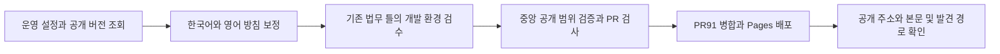

# 루시드 체스 제품별 방침 공개

2026년 10월 24일 사용자가 현재 대화에서 “남은 보관 기간과 삭제 절차, 실제 배포된 앱 동작을 확인하고 개인정보 방침 PR #91도 공개까지 마무리해.”라고 지시했다. 이 지시로 기존 검토본을 사실에 맞게 보정하고 공식 사이트에 공개한 뒤 실제 주소를 확인한다. 앱 빌드 배포, 실제 사용자 자료 삭제, 보관 설정 변경과 스토어 콘솔 수정은 이 범위에 넣지 않는다.

## 변경과 근거

GA4의 사용자와 이벤트 보관은 각각 14개월이며 새 활동에 따른 사용자 보관 갱신이 켜져 있다. 앱 분석 내보내기는 60일, 서버 이벤트와 감사 파티션은 400일, 일반 서비스 로그는 30일, 필수 감사 로그는 400일이다. 자동 삭제 접수는 이 앱에 활성화돼 있지 않으므로 이메일로 요청을 접수하고 대상 확인 후 운영자가 처리하는 절차를 고지한다. 연결되지 않은 분석 자료의 식별 제약과 제공자의 사본 제거 기간을 구분한다. 삭제 실행이나 설정 변경으로 검증하지 않는다.

공개 버전은 Google Play 3.0.26(1003000026), App Store 3.0.26(12), 앱인토스 3.0.21 소스 번들이다. 마켓 조회, Play 서명 APK와 권한, 공개 소스 및 실제 수신한 분석 이벤트를 대조한다. 개발 main에만 있는 적립 힌트를 현재 공개 버전의 기능이라고 설명하지 않는다. 현재 작업에서 기기를 조회하거나 조작하지 않으며 새 실기기 검수로 보고하지 않는다.

## 검수와 운영

기존 LegalDocPage의 내용과 링크 보정이며 레이아웃을 바꾸지 않는다. L1 dev로 두 언어 본문과 기간 및 삭제 안내, 작은 화면과 데스크톱, 언어 전환, 이메일 링크, canonical과 hreflang, 법무 인덱스와 sitemap을 확인한다. TDD는 고지 내용에 적용하지 않고 운영 원장 대조, 타입 및 빌드 검사와 실제 로컬 렌더링을 대체 근거로 사용한다. 게임이나 네이티브 SDK 코드는 바꾸지 않는다.

현재 공개 사이트의 main d7c9406을 기준으로 기능 목록을 정리해 중앙 검증기에 실제 웹 실행을 제출한다. 검수 대상은 법무 문서, 제품 원장과 검색 경로이며 release는 web/public이다. 사용자의 이번 공개 지시를 승인 근거로 기록한다. 코드 검토의 기존 실행 상한 이력은 보존하고 PR의 리뷰 회차 상한을 늘리지 않는다.

공개 전에는 타입 검사, 빌드, 관련 페이지 확인, PR 검사와 중앙 before-deploy 검증을 통과한다. 병합 후 Pages 성공과 배포 SHA, 두 제품별 주소의 200 및 실제 본문, 공통 방침과 법무 인덱스 및 sitemap을 다시 확인한다. 배포 실패 시 성공으로 기록하지 않고 기존 공통 방침 링크를 유지한 채 원인을 고친다. 되돌림이 필요하면 이 PR의 방침 및 경로 변경을 후속 PR로 되돌린다.
